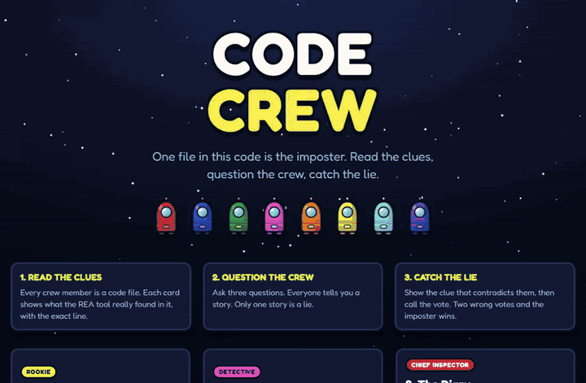
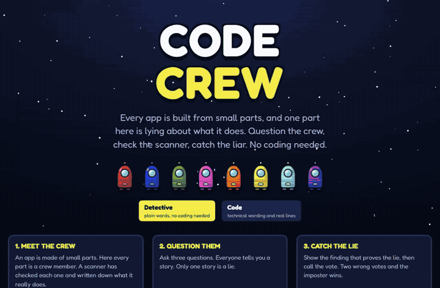

# Code Crew

**A detective game: one part of an app is lying about what it does.** Question the crew, check what the scanner found, catch the liar, then call the vote.

Every crew member is a code file. Every clue card is a **real finding from [REA](https://github.com/morluto/rea)**, a code-analysis tool, run on small sample apps built for this game. Each card traces back to an exact file, line and column.

**Two ways to play, same cases, same clues:**

| Detective mode (default) | Code mode |
|---|---|
| Plain words, no coding needed. A coach line tells you the next step. The code behind each clue is one click away. | Technical wording, file names, the real line of code with file:line:column, and the import cables. |
|  |  |

## Play

Eight cases, each a tiny app with six or seven parts. They are ordered by difficulty:

| # | Case | Level | The twist |
|---|---|---|---|
| 1 | The Telemetry Leak | Rookie | A "telemetry" file says it only counts plays. |
| 2 | The Janitor Who Looked Around | Rookie | A backup helper browses your whole home folder. Touching files is not the crime, *which* files is. |
| 3 | The Quiet Courier | Detective | The imposter hides what it loads and disguises where it sends data. |
| 4 | The Helpful Updater | Detective | An "update check" starts programs and sends your user name. Another file starts a program too, but honestly. |
| 5 | The Camera in the Hallway | Detective | Two files use the network. One talks to a private address inside the house, the other to an outside server. |
| 6 | The Diary Nobody Asked For | Chief Inspector | The scariest-looking file is innocent and says so. The quiet one is lying. |
| 7 | The Health Check | Chief Inspector | A password locker (written in CommonJS) with a "counter" that reads a secret token. |
| 8 | The Night Shift | Master | Seven suspects, and the loud ones are honest. The liar has the smallest story and the longest evidence. |

Rules: start at 60, **+20** for each lie you catch with a clue, **-4** per question, **-5** per hint (three per case, from a nudge to a name), **-10** per wrong clue, **-20** per wrong vote. Two wrong votes and the imposter wins. After each case an "In real life" note says why the trick matters.

```
cd web
npm install
npm run dev        # http://localhost:5173
npm run build      # static site in web/dist (no backend, no API key)
```

## What is real and what is authored

| Real (from REA) | Written by us |
|---|---|
| The import / require graph between files | The crew's names and roles |
| Network requests (fetch, https, WebSocket, sockets), routes and server names | What each crew member *says* (their claims) |
| Reads of user name, host name, home folder, files, folder listings, deletes and environment variables (by name) | The briefings, hints and the "in real life" notes |
| Started programs (the command), repeating timers, dynamic imports, encoded strings | The sample apps themselves |

Each clue also has a plain-words sentence. Those are written once per kind of finding in `scripts/lib/rea-evidence.mjs`, not by hand per case, so Detective mode and Code mode always show the same facts.

The build refuses a case unless **exactly the imposter lies** and every claim can be checked against a REA finding. `scripts/cases.test.mjs` re-checks that every clue in the shipped files exists in REA's raw output, that the raw output has not changed, that every snippet matches the source file, that every clue has plain wording, that only the last hint names the imposter, and that no ship file contains a spoiler word.

REA does **not** list the contents of a request body. So "it sends your score" is never shown as a finding: the cards say what REA saw (it reads the user name, it builds a request to that server). REA also does not report `eval` or `new Function`, so no case depends on them.

## How a case is built

```
cases/<id>/ship/                the sample app (the "ship"), ES modules or CommonJS
cases/<id>/case.config.json     crew, roles, claims, hints, briefings, the imposter (our story)
        |
        |  node scripts/run-rea.mjs <id>       (needs Node 22.19+)
        v
cases/<id>/rea-raw/*.json       REA's raw output, committed so the game never needs REA installed
        |
        |  node scripts/build-case.mjs
        v
web/public/cases/<id>.json      what the game reads
```

REA is pinned (`tools/package.json`, rea-agents 6.7.0) and installed with `--omit=optional --ignore-scripts`. It analyses the files as inert text and never runs them. To add a case: write a ship, run `run-rea.mjs`, look at what REA found with `node scripts/show-evidence.mjs <id>`, write the config against those findings, run `node scripts/build-case.mjs`, then `node --test scripts/`.

## Tests

```
node --test scripts/                       # cases: clues are real, story holds up, hints fair, no spoilers
node --test web/src/game.test.ts           # rules: scoring, hints, voting, and the ideal detective can win every case (Node 22.18+)
```

## Art

The look is a dark space ship with bold crew colours, flat cartoon shading and thick outlines. The crew are **original** "pod bots" (capsule body, round porthole, antenna). No other game's characters, code or assets are used.

## Limits

- Eight small, hand-built sample apps. This is a game about reading code evidence, not a security scanner.
- REA reports static facts. Static imports and relationships do not prove what runs, and REA says so in its own output.
- Case difficulty has been tested only by the unit tests (an ideal player can win each case, with or without all three hints, and no innocent can be caught out). It has not been playtested with people yet, so the difficulty labels are the author's guess.
